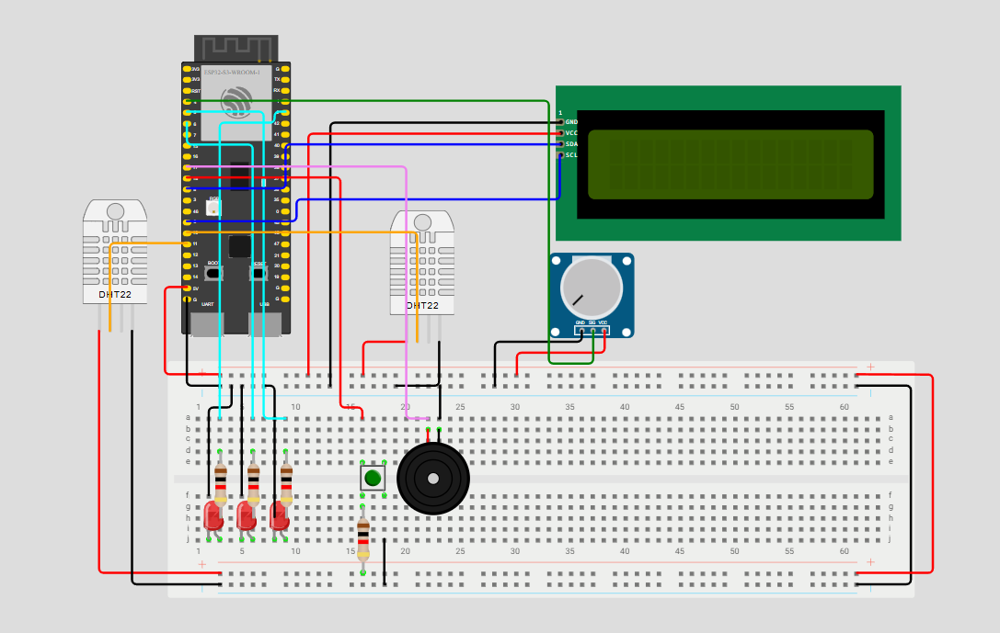
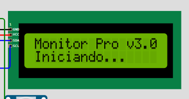
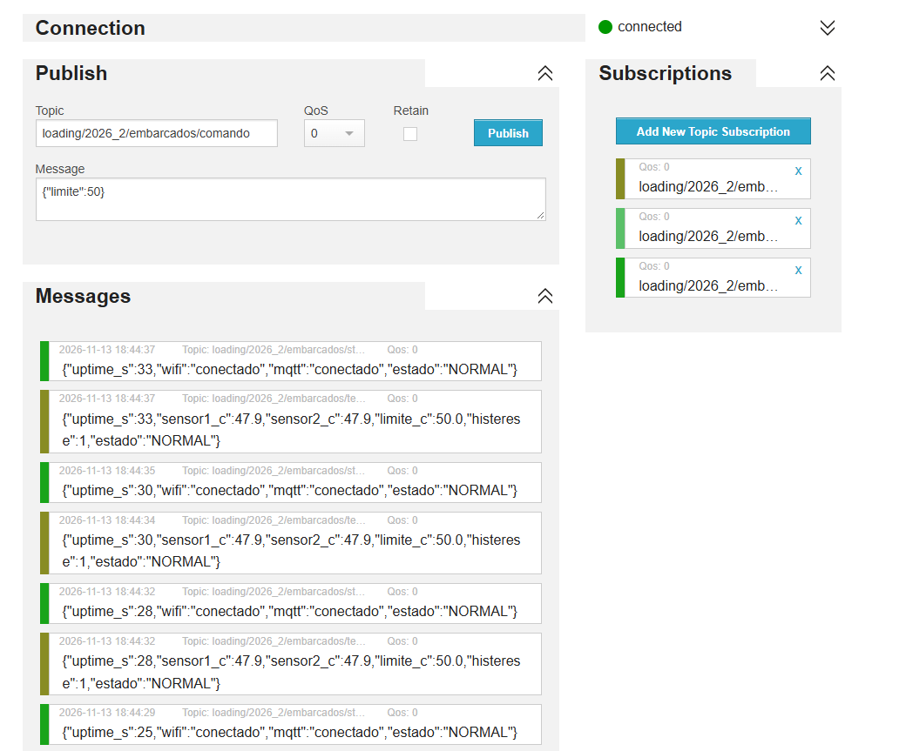

# 🌡️ Sistema Inteligente de Monitoramento de Temperatura — Loading

Sistema embarcado para monitoramento contínuo de temperatura, desenvolvido com ESP32-S3, utilizando sensores redundantes, comunicação MQTT e mecanismos de detecção de falhas. O projeto permite acompanhar as condições térmicas em tempo real, consultar históricos de medições e configurar limites de temperatura tanto remotamente quanto diretamente pelo hardware.

O projeto foi desenvolvido como parte do processo seletivo para a vaga de Desenvolvedor com foco em Sistemas Embarcados 2026.2 da **Loading Jr.**

---

## 📌 Sumário

- [Visão Geral](#-visão-geral)
- [Funcionalidades](#-funcionalidades)
- [Arquitetura do Sistema](#-arquitetura-do-sistema)
- [Estrutura do Projeto](#-estrutura-do-projeto)
- [Tecnologias e Dependências](#-tecnologias-e-dependências)
- [Hardware Utilizado](#-hardware-utilizado)
- [Comunicação MQTT](#-comunicação-mqtt)
- [Instalação e Configuração](#-instalação-e-configuração)
- [Execução do Projeto](#-execução-do-projeto)
- [Estados de Funcionamento](#-estados-de-funcionamento)
- [Demonstração](#-demonstração)
- [Autor e Repositório](#-autor-e-repositório)

---

## 🔎 Visão Geral

O projeto consiste no desenvolvimento de um sistema embarcado de monitoramento de temperatura, utilizando dois sensores para garantir maior confiabilidade na aquisição de dados.

A aplicação realiza leituras periódicas, identifica possíveis inconsistências nos sensores, classifica as condições de funcionamento e disponibiliza as informações por meio de comunicação MQTT.

Além do monitoramento, o sistema oferece mecanismos de interação local e remota, permitindo que o usuário configure o limite máximo de temperatura por meio de um potenciômetro ou de mensagens MQTT.

O sistema também mantém um histórico das medições, possibilitando a análise dos valores individuais e de suas respectivas médias móveis.

### Objetivos principais

- Monitorar continuamente a temperatura do ambiente.
- Garantir maior confiabilidade por meio da redundância de sensores.
- Identificar situações normais, alertas e falhas operacionais.
- Disponibilizar informações em tempo real por MQTT.
- Permitir a configuração dinâmica do limite de temperatura.
- Armazenar e disponibilizar o histórico de medições.

---

## 🚀 Funcionalidades

### 1. Monitoramento redundante de temperatura

O sistema utiliza dois sensores de temperatura independentes para realizar as medições.

Essa abordagem proporciona maior confiabilidade, permitindo identificar falhas individuais e manter o monitoramento enquanto houver um sensor operacional.

### 2. Detecção e classificação de estados

O sistema diferencia três condições principais de funcionamento:

| Estado | Descrição |
| --- | --- |
| 🟢 Normal | Temperatura dentro do limite configurado e funcionamento adequado dos sensores. |
| 🟡 Alerta | Temperatura igual ou superior ao limite estabelecido. |
| 🔴 Falha | Falha persistente na leitura dos sensores, após mais de três ocorrências consecutivas. |

A tolerância a falhas consecutivas foi implementada para evitar classificações incorretas causadas por ruídos e instabilidades momentâneas nas leituras dos sensores.

### 3. Histórico de temperaturas

O sistema disponibiliza o histórico das temperaturas registradas, permitindo duas formas de análise:

- **Valores individuais:** acompanhamento das medições realizadas pelos sensores.
- **Média móvel:** análise da tendência de temperatura, reduzindo a influência de oscilações pontuais nas leituras.

### 4. Configuração dinâmica do limite de temperatura

O limite máximo de temperatura pode ser configurado de duas maneiras:

- **Localmente:** por meio do potenciômetro conectado ao circuito.
- **Remotamente:** por meio do envio de mensagens MQTT.

Essa funcionalidade permite adaptar o comportamento do sistema sem a necessidade de alterar o código-fonte ou realizar uma nova gravação do firmware.

### 5. Sinalização visual por LEDs

O sistema possui três LEDs responsáveis por indicar visualmente seu estado operacional:

| LED | Indicação |
| --- | --- |
| LED referente ao pino 2 | Funcionamento normal. |
| LED referente ao pino 6 | Condição de alerta de temperatura. |
| LED referente ao pino 5 | Condição de falha dos sensores. |

### 6. Comunicação MQTT

Integração com protocolo MQTT para publicação de informações e recebimento de comandos.

O sistema disponibiliza:

- Status atual de funcionamento.
- Dados de telemetria.
- Histórico de temperaturas.
- Recebimento de configurações remotas.

---

## 💻 Arquitetura do Sistema

A arquitetura foi desenvolvida de maneira modular, utilizando a ESP32-S3 como unidade central de processamento.

O microcontrolador recebe os dados dos sensores, processa as informações, identifica o estado operacional e gerencia as saídas físicas e a comunicação com o broker MQTT.

### Diagrama de arquitetura

```text
[ Sensores (DHT22 x2 + Potenciômetro) ] ──► sensor.cpp ──► filtro.cpp
                                                                │
[ Botão Físico (GPIO 18) ] ───────────────► controleEntradas.cpp│
                                                                ▼
                                                     dados_sistema / historico
                                                                │
                                                                ▼
                                                      estado_sistema.cpp
                                                                │
                     ┌──────────────────────────────────────────┼──────────────────────────────────────────┐
                     ▼                                          ▼                                          ▼
         [ atuadores.cpp ]                          [ display_lcd.cpp ]                         [ rede_mqtt.cpp ]
      (LEDs GPIO 2,5,6 + Buzzer)                   (Tela LCD 16x2 via I2C)                   (Publicação/Assinatura MQTT)
```

### Fluxo de funcionamento

1. Os sensores realizam as leituras de temperatura.
2. A ESP32-S3 recebe e processa os dados.
3. O sistema verifica a validade das leituras e contabiliza possíveis falhas consecutivas.
4. A temperatura é comparada com o limite configurado.
5. O estado operacional é atualizado.
6. Os LEDs são acionados de acordo com o estado identificado.
7. Os dados são disponibilizados por meio do MQTT.
8. O histórico de temperaturas é atualizado.
9. O sistema verifica possíveis alterações no limite de temperatura recebidas pelo MQTT ou pelo potenciômetro.

## 📁 Estrutura do Projeto

A organização do repositório segue a estrutura de um projeto PlatformIO:

```text
├── .pio/                        # Arquivos de build e dependências compiladas (ignorado pelo Git)
├── .vscode/                     # Configurações do ambiente de desenvolvimento
├── docs/
│   └── images/                  # Mídias de documentação e evidências de funcionamento
│       ├── circuito-completo.png
│       ├── demonstracao.mp4
│       ├── display-lcd.png
│       └── monitoramento-mqtt.png
├── include/                     # Arquivos de cabeçalho (.h) e definições de interface
│   ├── atuadores.h              # Controle de LEDs e Buzzer
│   ├── auxi.h                   # Funções auxiliares gerais
│   ├── config.h                 # Mapeamento de pinos, constantes e credenciais de rede/MQTT
│   ├── dados_sistema.h          # Estruturas de dados compartilhadas
│   ├── display_lcd.h            # Interface de comunicação com o LCD I2C
│   ├── estado_sistema.h         # Máquina de estados do sistema
│   ├── filtro.h                 # Algoritmos de filtragem de leitura dos sensores
│   ├── historico.h              # Armazenamento temporário / buffer de leituras
│   ├── logger_serial.h          # Formatação e saída de logs via UART
│   ├── rede_mqtt.h              # Gerenciamento de conexão Wi-Fi e protocolo MQTT
│   └── sensor.h                 # Leitura dos sensores DHT22 e Potenciômetro
├── lib/                         # Bibliotecas externas customizadas(não foi utilizado)
├── src/                         # Código-fonte principal
│   ├── atuadores.cpp
│   ├── auxi.cpp
│   ├── controleEntradas.cpp     # Tratamento de interrupções/leitura do botão físico
│   ├── dados_sistema.cpp
│   ├── display_lcd.cpp
│   ├── estado_sistema.cpp
│   ├── filtro.cpp
│   ├── historico.cpp
│   ├── logger_serial.cpp
│   ├── main.cpp                 # Ponto de entrada (setup/loop) e orquestração das tarefas
│   ├── rede_mqtt.cpp
│   └── sensor.cpp
├── test/                        # Testes unitários e de integração(não foi utilizado)
├── .gitignore                   # Regras de arquivos ignorados no versionamento
├── diagram.json                 # Esquema elétrico e posicionamento de componentes no Wokwi
├── platformio.ini               # Configurações de placa, framework e bibliotecas do PlatformIO
├── README.md                    # Documentação principal do repositório
└── wokwi.toml                   # Configuração de integração entre PlatformIO e simulador Wokwi
```

## 🔧 Tecnologias e Dependências

### Plataforma e ferramentas

| Tecnologia | Finalidade |
| --- | --- |
| C++ | Linguagem utilizada no desenvolvimento do firmware. |
| ESP32-S3 DevKitC-1 | Microcontrolador responsável pelo processamento do sistema. |
| PlatformIO | Ambiente de desenvolvimento, gerenciamento de dependências e compilação do firmware. |
| Visual Studio Code | Editor de código utilizado no desenvolvimento. |
| Wokwi | Plataforma de simulação do circuito eletrônico. |
| MQTT | Protocolo de comunicação para troca de mensagens. |
| HiveMQ | Broker MQTT utilizado na comunicação e visualização dos dados. |

### Bibliotecas utilizadas

| Biblioteca | Finalidade |
| --- | --- |
| `LiquidCrystal_I2C` | Controle e comunicação com o display LCD utilizando interface I2C. |
| `DHT sensor library` | Comunicação e leitura dos sensores de temperatura e umidade DHT. |
| `PubSubClient` | Implementação da comunicação MQTT, incluindo publicação e recebimento de mensagens. |
| `ArduinoJson` | Serialização e desserialização de mensagens no formato JSON. |

### Dependências do PlatformIO

As bibliotecas são gerenciadas automaticamente pelo PlatformIO por meio do arquivo `platformio.ini`.

```ini
[env:esp32-s3-devkitc-1]

platform = espressif32
board = esp32-s3-devkitc-1
framework = arduino

monitor_speed = 115200

lib_deps =
    marcoschwartz/LiquidCrystal_I2C@^1.1.4
    adafruit/DHT sensor library@^1.4.7
    knolleary/PubSubClient@^2.8
    bblanchon/ArduinoJson@^7.2.2
```

---

## 🔌 Hardware Utilizado

O projeto utiliza os seguintes componentes eletrônicos:

| Componente | Função |
| --- | --- |
| ESP32-S3 DevKitC-1 | Unidade central de processamento. |
| 2 sensores DHT | Aquisição redundante de temperatura. |
| Display LCD I2C | Exibição local de informações. |
| Potenciômetro | Ajuste local do limite de temperatura. |
| 3 LEDs | Para indicar o funcionamento. |
| Jumpers e conexões | Interligação dos componentes. |

---

## 📡 Comunicação MQTT

A comunicação entre o sistema embarcado e a plataforma de monitoramento utiliza o protocolo MQTT.

O broker utilizado é o **HiveMQ Public Broker**, permitindo acompanhar as mensagens publicadas pelo dispositivo e enviar configurações remotamente.

### Configuração do broker

| Parâmetro | Valor |
| --- | --- |
| Broker | `broker.hivemq.com` |
| Porta WebSocket | `8884` |
| QoS | `0` |

### Tópicos utilizados

O sistema trabalha com três tópicos principais:

| Tópico | Finalidade |
| --- | --- |
| `loading/2026_2/embarcados/status` | Publicação das informações relacionadas ao estado operacional do sistema. |
| `loading/2026_2/embarcados/telemetria` | Disponibilização dos dados de temperatura e telemetria. |
| `loading/2026_2/embarcados/historico` | Disponibilização do histórico de temperaturas. |
| `loading/2026_2/embarcados/comando` | Alteração do limite de temperatura considerado máximo aceitável |

### Monitoramento das mensagens

Para visualizar as mensagens MQTT, utilize o cliente WebSocket disponibilizado pelo HiveMQ:

[HiveMQ WebSocket Client](https://www.hivemq.com/demos/websocket-client/)

As instruções de conexão e inscrição nos tópicos estão disponíveis na seção de instalação.

---

## 📋 Instalação e Configuração

### Pré-requisitos

Antes de iniciar, certifique-se de possuir:

- [Visual Studio Code](https://code.visualstudio.com/) instalado.
- Extensão [PlatformIO IDE](https://platformio.org/install/ide?install=vscode) instalada no VS Code.
- Extensão [Wokwi Simulator](https://marketplace.visualstudio.com/items?itemName=Wokwi.wokwi-vscode) instalada, caso deseje executar a simulação.
- Cabo USB compatível com a ESP32-S3, caso utilize o hardware físico.
- Acesso à internet para comunicação MQTT e instalação das dependências.

### 1. Instalação do PlatformIO

1. Abra o Visual Studio Code.
2. Acesse a aba de extensões.
3. Pesquise por `PlatformIO IDE`.
4. Instale a extensão.
5. Aguarde a conclusão da instalação e inicialização do ambiente.

### 2. Configuração do cliente MQTT

Para acompanhar as mensagens trocadas entre a ESP32 e o broker, utilize o cliente WebSocket do HiveMQ.

1. Acesse: [https://www.hivemq.com/demos/websocket-client/](https://www.hivemq.com/demos/websocket-client/).
2. No campo **Host**, informe:

   ```text
   broker.hivemq.com
   ```

3. No campo **Port**, informe:

   ```text
   8884
   ```

4. Clique em **Connect** para estabelecer a conexão.
5. Acesse a seção **Subscriptions**.
6. Adicione os três tópicos abaixo, individualmente, configurando todos com QoS `0`:

   ```text
   loading/2026_2/embarcados/status
   ```

   ```text
   loading/2026_2/embarcados/telemetria
   ```

   ```text
   loading/2026_2/embarcados/historico
   ```

Após concluir essas etapas, o cliente estará preparado para receber as mensagens publicadas pelo dispositivo.

**Observação:** o broker público HiveMQ não exige autenticação nessa configuração. Como é um serviço público, evite publicar informações sensíveis nos tópicos.

### 3. Clonagem do repositório

Abra um terminal e execute:

```bash
git clone https://github.com/ChriXPva/PS-Loading.git
```

Entre no diretório do projeto:

```bash
cd PS-Loading
```

### 4. Abertura do projeto no PlatformIO

1. Abra o Visual Studio Code.
2. Acesse a página inicial do PlatformIO.
3. Selecione a opção **Open Project**.
4. Navegue até o diretório onde o repositório foi clonado.
5. Selecione a pasta `PS-Loading`.
6. Aguarde o PlatformIO reconhecer o projeto e instalar as dependências configuradas no arquivo `platformio.ini`.

---

## ⚡ Execução do Projeto

O sistema pode ser executado de duas maneiras: utilizando o hardware físico ou por meio da simulação no Wokwi.

### Opção 1: Execução em hardware físico

1. Conecte a ESP32-S3 ao computador utilizando um cabo USB compatível com transmissão de dados.
2. Abra o projeto no Visual Studio Code com o PlatformIO.
3. Aguarde a instalação das dependências.
4. Verifique se a placa foi reconhecida pelo computador.
5. Selecione a opção **Upload** na barra de ferramentas do PlatformIO.
6. Aguarde a compilação e gravação do firmware na placa.
7. Após a conclusão, o sistema estará pronto para execução.

Para acompanhar as mensagens de depuração, utilize o **Serial Monitor** do PlatformIO, configurado para operar em 115200 baud.

### Opção 2: Execução por simulação no Wokwi

Para executar o projeto sem a necessidade do circuito físico:

1. Abra o projeto no Visual Studio Code.
2. Aguarde a instalação das dependências do PlatformIO.
3. Execute o processo de compilação utilizando a opção **Build**.
4. Instale e configure a extensão Wokwi Simulator, caso ainda não tenha feito isso.
5. Caso seja solicitado, siga as instruções da extensão para obter e configurar sua chave de acesso do Wokwi.
6. Após a configuração, localize a opção **Start Simulation** na extensão.
7. Clique para iniciar a simulação do circuito.

O Wokwi utilizará a configuração do projeto para carregar os componentes e executar o firmware compilado.

## 🚦 Estados de Funcionamento

O sistema realiza o monitoramento contínuo das condições de temperatura e da integridade dos sensores.

A classificação dos estados permite identificar rapidamente a situação operacional do dispositivo.

### Estado normal

Ocorre quando as leituras estão válidas e a temperatura permanece abaixo do limite configurado.

- LED do pino 2 acionado.
- Monitoramento em funcionamento.
- Publicação das informações via MQTT.

### Estado de alerta

Ocorre quando a temperatura atinge ou ultrapassa o limite configurado.

- LED do pino 6 acionado.
- Condição de alerta identificada.
- Atualização das informações disponibilizadas via MQTT.

### Estado de falha

Ocorre quando são identificadas mais de três falhas consecutivas nas leituras dos sensores.

Essa estratégia considera que os sensores podem apresentar falhas pontuais devido a ruídos e instabilidades momentâneas. Dessa forma, o sistema evita classificar uma ocorrência isolada como uma falha persistente.

- LED do pino 5 acionado.
- Condição de falha identificada.
- Atualização do estado operacional via MQTT.

---

## 📸 Demonstração

Esta seção está reservada para apresentar visualmente o funcionamento do projeto.

### Circuito eletrônico



### Display LCD



### Monitoramento MQTT



### Simulação

docs/images/demonstracao.mp4

---

## 👨‍💻 Autor e Repositório

Projeto desenvolvido como parte do processo seletivo para a vaga de Desenvolvedor com foco em Sistemas Embarcados 2026.2 da **Loading Jr.**

**Repositório oficial:**

[ChriXPva/PS-Loading](https://github.com/ChriXPva/PS-Loading)

---

*Desenvolvido com foco em confiabilidade, monitoramento e sistemas embarcados.*
